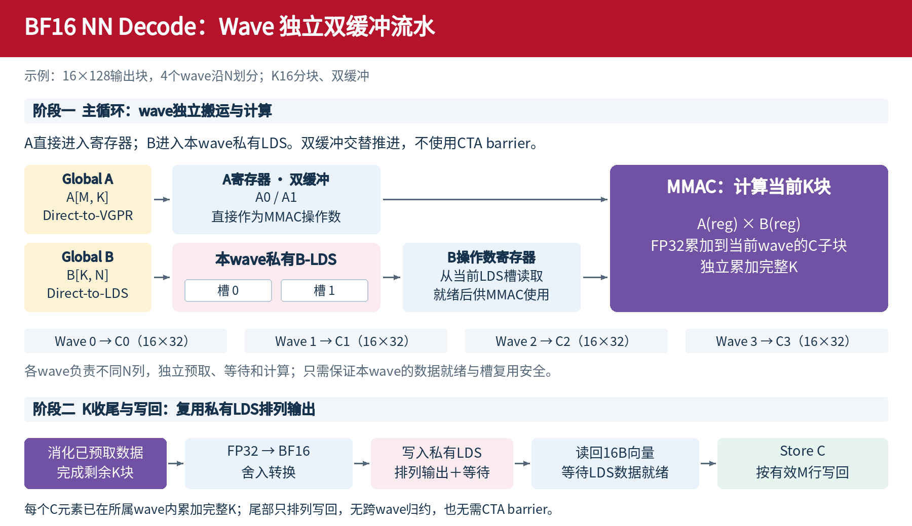

# BF16 NN Decode：Wave 独立双缓冲流水

[可编辑 SVG](decode_a_register_b_private_lds.svg) · [PDF](decode_a_register_b_private_lds.pdf)

图采用四个wave、K16分块和双缓冲的代表结构：每个CTA输出16×128，每个wave负责其中16×32的不同N列，并独立累加完整K。

A直接从显存加载到操作数寄存器；B从显存直接进入各wave独占的LDS槽，随后读入寄存器供MMAC使用。主循环通过双缓冲交替推进预取和计算，只需等待本wave的数据就绪及安全复用槽。

收尾完成剩余K块，将FP32结果舍入为BF16，复用本wave的B-LDS空间排列输出，等待写入完成后读回16B向量，再按有效M行写回C。全程无需CTA barrier，也不做跨wave结果归约。

图仅说明流水结构，方块宽度不代表实际耗时。
