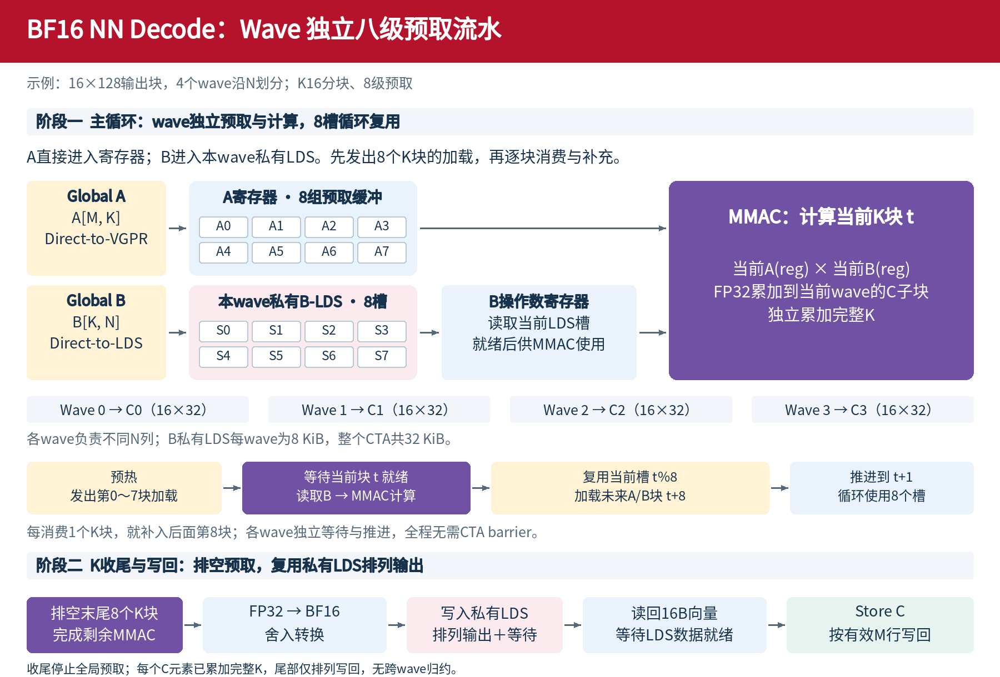

# BF16 NN Decode：Wave 独立八级预取流水

[可编辑 SVG](decode_wave_eight_stage_prefetch.svg) · [PDF](decode_wave_eight_stage_prefetch.pdf)

各wave沿N方向负责不同输出块，独立累加完整K。A直接进入8组寄存器缓冲，B进入本wave私有的8槽LDS；先发出第0～7个K块的加载，消费当前块t后，复用对应槽预取t+8。收尾停止预取并排空末尾8块，将FP32结果转为BF16，复用私有LDS排列后，以16B向量写回C，全程无需CTA barrier或跨wave归约。

图采用每CTA输出16×128、四wave各16×32、K16分块的已实现代表结构。8级路径要求K≥128且K%128=0，每wave B-LDS为8 KiB、CTA共32 KiB；8级表示预取缓冲深度，架构仍分主循环与收尾两个阶段。图仅说明流水结构，方块宽度不代表实际耗时。源码依据与检查见eight_stage_validation.json，渲染入口draw_eight_stage.py；未启动GPU实验。

## 双缓冲结构对照

[可编辑 SVG](decode_a_register_b_private_lds.svg) · [PDF](decode_a_register_b_private_lds.pdf)

图采用四个wave、K16分块和双缓冲的代表结构：每个CTA输出16×128，每个wave负责其中16×32的不同N列，并独立累加完整K。

A直接从显存加载到操作数寄存器；B从显存直接进入各wave独占的LDS槽，随后读入寄存器供MMAC使用。主循环通过双缓冲交替推进预取和计算，只需等待本wave的数据就绪及安全复用槽。

收尾完成剩余K块，将FP32结果舍入为BF16，复用本wave的B-LDS空间排列输出，等待写入完成后读回16B向量，再按有效M行写回C。全程无需CTA barrier，也不做跨wave结果归约。

图仅说明流水结构，方块宽度不代表实际耗时。
