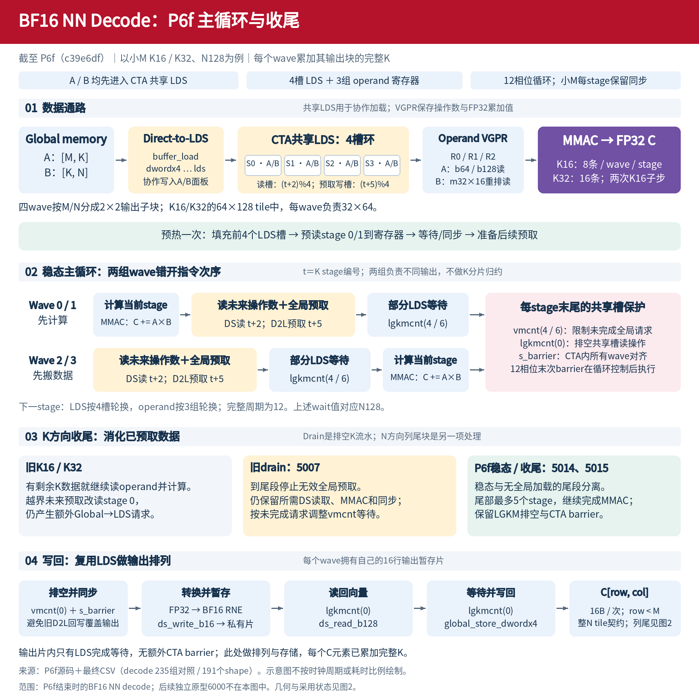
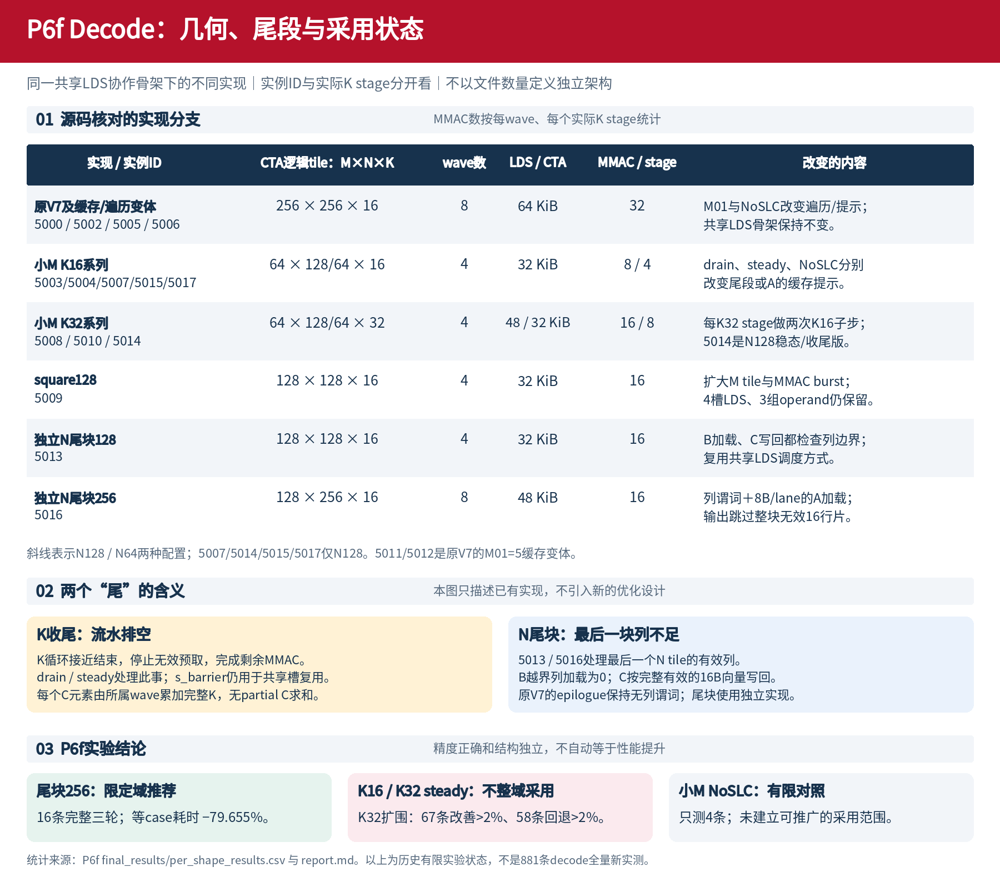

# P6f结束时的BF16 NN Decode流水图

按用户要求，使用“主循环＋收尾”的架构图呈现P6f结束时已有实现。
源码固定到本地提交`c39e6df67de0a07d2f89ef224f421a99ed6ee9ca`，不包含后续P6h
实例6000的A寄存器/B私有LDS或A私有LDS/B寄存器原型。所有图均由源码与既有
CSV记录整理；本次只生成文档，没有编译或启动GPU测试。

优先阅读[一页架构简版（PNG）](p6f_decode_concise.png)：只保留一条代表流水的
主循环与收尾，把实例ID、等待数值、12相位和性能记录移到下面的参考图。
另有[简版PDF](p6f_decode_concise.pdf)、[简版SVG](p6f_decode_concise.svg)。

- [图1：主循环、K收尾与输出写回（PNG）](p6f_decode_main_tail.png)
- [图2：各实现的几何、尾段差异及采用状态（PNG）](p6f_decode_variants.png)
- [两页PDF，适合分享](p6f_decode_pipeline.pdf)
- [图1可编辑SVG](p6f_decode_main_tail.svg)、[图2可编辑SVG](p6f_decode_variants.svg)





## 图的含义与范围

图1以小M K16/K32、N128为例。原V7、square及列尾块也使用CTA共享LDS的
协作骨架，但实际几何、数据布局、等待计数、写回谓词并不完全相同，见图2。
图中箭头表达依赖和指令次序，不代表每条指令占用的时钟周期或耗时比例。

小M K16/K32的数据路径为：A/B从全局内存协作加载到CTA共享LDS，LDS以4槽
循环，操作数以3组VGPR循环，再执行MMAC并累加FP32输出；两组wave使用不同
指令次序推进。每个wave负责不同的M/N输出子块，均遍历完整K。

这里有两种不同的“尾”：

- K收尾负责停止无效未来预取，完成剩余操作数读取和MMAC，并排空在途请求。
  原小M K16/K32仍将超出范围的未来预取改读stage0；旧drain5007抑制这些加载；
  P6f5014/5015进一步分开稳态与无全局加载的尾段，保留必要同步。
- N尾块处理最后一个N tile列数不足。独立5013/5016同时给B加载和C写回增加列
  边界处理，未改动原V7的无列谓词epilogue契约。BF16输出按8个元素/16B向量写回。

写回前用`vmcnt(0)+s_barrier`保证旧Direct-to-LDS写回不会破坏输出；然后每个
wave复用自己的16行LDS片完成BF16转换、排列和向量存储。片内有LDS完成等待，
没有额外CTA barrier，也没有跨wave partial C求和。

图1中每stage的`lgkmcnt(4/6)`和`vmcnt(4/6)`针对小M K16/K32的N128配置。
原V7256方块的阶段调度使用自己的partial-LGKM等待和VMEM等待，不能直接套用
小M新增的`lgkmcnt(0)`。N64等配置也按其实际请求数计算等待值。

## 与CSV和性能结论的对应

原始文件是[P6f最终逐shape对照](../v7_optimization_p6f/final_results/per_shape_results.csv)。
它共288组对照、209个不同shape；其中M≤256的decode有235组对照、191个不同shape。
这些数字已重新读取CSV核对。它不是881条decode的重新全量实测。

P6f结束时的结论保持不变：限定属性域的N尾块256推荐采用；小M K16/K32新稳态/
收尾没有建立整域稳定收益，K32扩围159条中67条改善>2%、58条回退>2%；小M NoSLC
只有4条隔离对照。所有实验开关仍默认关闭，不把架构图当作性能提升或生产启用的证明。
完整结论见[P6f最终报告](../v7_optimization_p6f/final_results/report.md)。

## 源码依据

`facts.json`列出冻结提交、每个已核对源码文件的SHA256、CSV哈希和几何。
主要对应源码如下（链接可定位当前工作区文件；图内容以冻结提交为准）：

- [小M K16](../../../include/ck_tile/ops/gemm/pipeline/gemm_pipeline_v7_small_m.hpp)
- [小M K32](../../../include/ck_tile/ops/gemm/pipeline/gemm_pipeline_v7_small_m_k32.hpp)
- [旧drain](../../../include/ck_tile/ops/gemm/pipeline/gemm_pipeline_v7_small_m_drain.hpp)
- [P6f K16稳态/收尾](../../../include/ck_tile/ops/gemm/pipeline/gemm_pipeline_v7_small_m_k16_steady.hpp)
- [P6f K32稳态/收尾](../../../include/ck_tile/ops/gemm/pipeline/gemm_pipeline_v7_small_m_k32_steady.hpp)
- [小M写回](../../../example_hcu/ck_tile/19_grouped_gemm/grouped_gemm_v7_small_m_epilogue.hpp)
- [N尾块256写回](../../../example_hcu/ck_tile/19_grouped_gemm/grouped_gemm_v7_tail256_epilogue.hpp)

## 重新生成

脚本只依赖Python/Pillow和一个中文字体，不调用GPU。示例：

```bash
python3 build_diagrams.py --font /path/to/NotoSansCJKsc-Regular.otf
```

本次渲染使用[Noto CJK](https://github.com/notofonts/noto-cjk)的
`Sans/OTF/SimplifiedChinese/NotoSansCJKsc-Regular.otf`（SIL Open Font License）。
字体SHA256为`2c76254f6fc379fddfce0a7e84fb5385bb135d3e399294f6eeb6680d0365b74b`。
字体文件不放入本仓库。PNG/PDF已经栅格化，不依赖接收方安装字体；SVG保留可编辑
文字，使用Noto Sans CJK SC或系统中文字体显示。

两张PNG均已实际查看，中文、箭头、表格和边界完整；程序另检查文本边界与最小字号，
结果见`render_validation.json`。未修改kernel、selector、shape或测试数据。

简版用`build_concise.py --font /path/to/NotoSansCJKsc-Regular.otf`重新生成，
同样只调用CPU。它以小M K16/K32为代表，不把N尾块、原V7的特殊等待或后续独立
原型混在一个时序里。两组wave的方块宽度不表示耗时。

## 与用户提供的同事示意图区别

这里只比较用户图片中的标注，没有核验同事源码或性能。

- NN decode图：wave沿K分片，A直达VGPR、B进入wave私有LDS，主循环0 CTA barrier，
  尾部合并partial C。P6f这里的wave按M/N分配输出、各自遍历完整K，A/B协作进入
  CTA共享LDS，主循环有必要CTA barrier，尾部做BF16转换和输出排列。
- NT decode图：全员协作，A/B经过VGPR写入单缓冲共享LDS，以WAR/RAW同步保护覆盖。
  P6f也属于协作式组织，但使用Direct-to-LDS和四槽循环，不能套用单缓冲时序。
- NN prefill Ring4图：A/B Direct-to-LDS、四槽共享LDS、分组错开计算搬运，与P6f
  这里最接近。按该图标注其operand是两组、读t+1/预取t+4；P6f小M源码使用三组
  operand、读t+2/预取t+5。相近的存储层次不代表数值类型、等待计数和性能一致。

此前详图同时列出了多个变体、源码细节和实验状态，信息层次比同事每张只讲一种
流水的图更细。这是表现范围的区别，不能据图的繁简判断实现优劣或优化效果。
