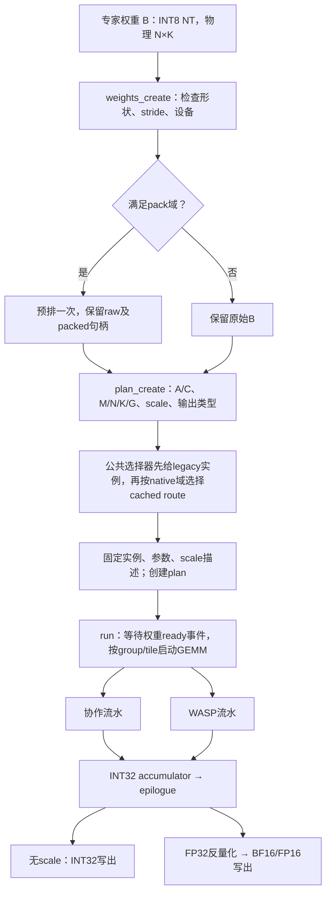

# INT8 NT当前状态与实现流程

> v140更新：已把低G长K prepared-B协作实例接入scaled生产route24。仅uniform非空M<=8、N4096、K6144/7168、G8、80CU且已预排权重启用。48条邻域两输出均PASS，ID1017/1087/1088的BF16独立复测达到目标；全量统计仍等待新1191回归。两家族不变，scaled实例42种（23 Cooperative+19 WASP）。route24的A/B主循环直接进VGPR，输出仍使用4096B LDS交换。

> 更新：v139已验证一项scaled分流改进。ID992切到已有route12，BF16 645.994 TOPS（R1.03993），FP16 649.253 TOPS（R1.04517）；6条邻域两输出均PASS，126个设备kernel与v136逐byte一致。最近完整1191回归仍为下文v136，未混入局部复测数据。详见MAX_ALL_OPTIMIZATION_LOG.md的v138/v139记录。

记录日期：2026-11-05。适用仓库分支为`exp/int8_nt`、目录`example_hcu/ck_tile/24_grouped_gemm_int8_nt`。当前完整验收版本是v136；v137单B缓冲实验已完成，未接入默认分流。本文梳理已存在的实现，不启动新实验，也不将代表shape初筛成绩当作全量成绩。

## 1. 当前状态

### 1.1 固定目标与正式结果

目标是指定Excel第三页`int8_NT`的P列Max ALL，共1191条。该列是不同BLAS模式最优值的最大值，作为固定工程吞吐目标；不是原生BLAS与当前per-channel输出语义逐项一致的声明。INT8吞吐单位为TOPS，MAC按2操作计算。

正式口径：INT8×INT8、INT32累加，group标量A scale与per-channel B scale，在GEMM kernel内反量化，分别写BF16/FP16。原无scale INT32接口独立保留。验收必须完整输出数值PASS并且`R=CK_TOPS/目标TOPS>=1`；`0.99<=R<1`仍属于未严格达标。

| 输出 | phase | 用例数 | 数值PASS | 性能严格达标 | 未严格达标 | 最小R |
|---|---|---:|---:|---:|---:|---:|
| BF16 | prefill | 310 | 310 | 249 | 61 | 0.942695 |
| BF16 | decode | 881 | 881 | 867 | 14 | 0.952208 |
| BF16 | 全部 | 1191 | 1191 | 1116 | 75 | 0.942695 |
| FP16 | prefill | 310 | 310 | 262 | 48 | 0.956770 |
| FP16 | decode | 881 | 881 | 869 | 12 | 0.952776 |
| FP16 | 全部 | 1191 | 1191 | 1131 | 60 | 0.952776 |

原1178条加补充13条，共881 decode、310 prefill。未达标并集为75条；FP16的60条均包含在这75条中。最差BF16还需约6.08%的吞吐提升才能达到目标，最差FP16约需4.96%；不能将“低于目标5.73%”与“需要提升5.73%”混用。

数据：[完整双输出CSV](max_all_v136_1191.csv)、[剩余75条](max_all_v136_remaining.csv)、[全量审计](max_all_v136_summary.json)。一轮正式测量，每条10次预热、50次重复、3样本中位数。全量输入[-8,8]、TF32关闭、分块完整输出参考；另有full-range INT8/FP64边界及scale门禁。全量0失败、0跳过，不用其它轮次的最快值替换。

### 1.2 版本与本轮实验

| 层级 | 状态 | 说明 |
|---|---|---|
| v136正式实现 | 保持 | 实现06a442c；结果归档41a871a；生产API库SHA256为e026eeccd82efada138891ffeccdb36bae9523dae570c4add1cee63c46a8d924 |
| v137单B缓冲 | 仅tuning可选，不推广 | 实现86e9e1b；648项full-range检查PASS，216项非法域启动前拒绝；16个shape、320项初筛完整输出PASS |
| 当前默认分流 | 沿用v136 | v137库中的旧生产126个kernel机器码与v136逐函数完全相同；未改变无scale INT32及其它16位输入接口 |
| 当前测试进程 | 本轮已结束 | 构建、门禁与初筛进程均已退出，done记录完整；未启动后续正式复测或新实验 |

v137单B缓冲把BM128/BN384的VGPR降至95/103，LDS为32KiB，HIP查询的每CU最大驻留由1CTA变成2CTA，384个kernel均无spill。但16个样本上，四个单B实例中的最佳值相对默认，BF16吞吐比中位数0.936、FP16为0.906；没有新增填平本轮默认未达标项。它同时损失单wave预取重叠，资源减少不等于整体变快。此为初筛负结果，不是所有单缓冲设计都无效的证明。

原始与审计：[v137初筛CSV](max_all_v137_single_b_screen.csv)、[初筛汇总](max_all_v137_screen_summary.json)、[门禁/资源/机器码](max_all_v137_validation_resources.json)。此前审批服务短暂阻止构建/推送，恢复后已正常完成；`max_all_v137_local_preflight.json`保留的是恢复前的历史快照。

### 1.3 目前的判断

近期有效的生产改进主要是v128的scaled实例选择和v136的无效N消费者屏蔽；还没有测到一套能稳定替换当前大M主干的新流水。单边LDS、纯寄存器、紧凑LDS、地址简化、B单缓冲都提供了局部证据，但不能将局部同tile收益或静态驻留提升当作全量收益。当前不具备声称达到硬件上限的证据。

继续围绕旧结构只扫描tile/缓冲参数，收益已有限。先明确每条路径的数据布局、复用范围、同步和输出代价，再判断是否需要改变consumer任务划分或权重供给方式。未验证方向保留为讨论项，不预告必然收益。

## 2. 先明确形状与输出契约

对每个专家e：`A_e[M_e,K] × B_e[N,K]^T -> C_e[M_e,N]`。外部NT表示物理B按`[N,K]`保存；并不是要求调用者额外转置一份B。全量清单采用同次调用各专家M相等，G/E是专家组数，M是每个专家的行数，工作量为`2*G*M*N*K`。

接口允许不同组M或空组，在适用域外走原选择器及通用路径；当前1191结果验证的是这份均匀shape清单，不代表已经测完任意ragged分布。`prefill/decode`是报告标签，runtime不读取phase、caseID、Excel或目标吞吐。

## 3. 总调用流程



权重准备与plan创建在稳态GEMM计时外；预排时间/额外存储需单列，不能隐藏为免费成本。动态A不预排。plan销毁先保证使用它的stream完成，权重仍被plan持有时不允许销毁。

## 4. 权重准备与实例分流

### 4.1 prepared B

当前pack域为`N%256==0`、`K%128==0`、`512<=K<16384`，还受ABI的指针对齐、正stride、矩阵span及共同N/K检查约束。合法时额外分配`G*N*K`字节，按K64/N16块组织为`[K/64,N/16,4,16,16]`，每lane连续搬16字节，供消费者直接读取。原始B保持可用；不是所有plan都必须使用packed B。

权重准备是独立预处理，不计作第三套GEMM流水，也不修改原有BF16/FP16输入算子。

### 4.2 选择顺序

1. `cached_api.cpp::make_plan`检查每组M、stride、空组/均匀性，并通过公共`select_grouped_gemm_candidate`获得legacy实例。
2. cached native域要求各组M相等且非空；M为32/64/128或正的256倍数；N为256倍数、K为128倍数且小于16384，还须满足矩阵span等限制。
3. native域外使用route0，由legacy实例分发；native域内按输出类型分别调用`int8_cached_route`或`int8_cached_scaled_route`。某些raw路线还检查对应输入stride小于16384。
4. route标识预编译实例，不是caseID。固定plan后，run不再读取测试表或逐次重新搜索实例。

| 路线 | 内容与主要条件 | 在1191正式数据中的条数 |
|---|---|---:|
| 0 | legacy分发；当前这667条均为Cooperative，但route0一般不能直接等同于Cooperative，因为legacy也能分发WASP | 667 |
| 1、3、4 | 原始输入WASP；3/4为逻辑转置，4使用record-stride策略 | 33 |
| 5 | packed BM256/BN256 WASP | 17 |
| 6、7 | packed BM128，BN256/128；含K768等scaled选择 | 131 |
| 8、9 | packed BM64，BN256/64；8也用于scaled低N族 | 90 |
| 10、11 | packed BM32，BN256/64 | 11 |
| 12 | packed BM256/BN384 WASP，通常比较grid调度批次数决定是否优于BN256 | 95 |
| 22、23 | v136 masked BM256/BN384 WASP，M-cluster4/8 | 147 |

总计667条Cooperative、524条WASP。表中14个实际出现的route值代表实例/策略，不是14套核心流水。路线2等可能被编译但本次清单未选到；v137的61–67只在tuning构建显式选择，默认不会进入。

scaled选择先处理N256/K512：M256–1024取route8，M>=2048取route6；N2048/K768、M>=2048取route6。随后v136 masked规则要求packed、80CU、M>=2048且整256、3584<=N<=8192且整256但不整384、1024<=K<16384且整128；K>=4096或N%384==128选23，否则22。其它情况回原尺寸/CTA批次策略。原无scale INT32选择不套用这些scaled覆盖。

M-cluster/MGroup是CTA访问顺序中的M tile聚类大小，不是专家G。它影响相邻CTA的A/B复用和grid取整；没有改变数学上的专家组数。

## 5. 协作流水：相同waves负责搬运与计算

当前默认主干在`grouped_int8_nt_pipeline.hpp`，`pipeline/cooperative.hpp`是兼容包含入口。

```text
prologue：Load(A0,B0)到VGPR → Stage到单份LDS → 同步可读
steady： Load(A_next,B_next)到VGPR
         当前LDS片段 → MMAC寄存器 → MMAC累加
         同步：所有waves已读完当前LDS
         Stage(next)覆盖LDS → 同步：下一块可读
tail：   计算最后一块 → epilogue
```

A/B沿连续K方向做16字节搬运；LDS承担搬运布局到MMAC fragment布局的重排与跨wave共享。前后都是VGPR，差别在每lane持有的数据排列。MMAC采用16×16×32 INT8指令，累加到INT32寄存器。默认使用输入单份LDS加下一块VGPR预取，不要称为A/B双份LDS缓冲。

不同BM/BN/BK、wave布局、MGroup、对齐/尾部处理、epilogue批量化组成实例。小M多数选择较窄BN与较深BK，控制浪费和任务数；不是简单按“decode全部走协作”硬分。

带scale的协作epilogue复用LDS把分散的accumulator重排成连续输出，再反量化写出。因此即使实验中A/B输入绕过LDS，也不能称整个kernel完全不用LDS。

### 5.1 一个小M实例的任务划分

以正式清单中的`M1/N4096/K7168/G8`为例，route0/legacy8734在scaled入口使用BM16/BN32/BK512、WM1/WN2，共128线程。两个wave分别负责同一M16范围的两个N16条带；整个调用有`8*(4096/32)=1024`个CTA，每CTA计算14个K512阶段。

实际只有1行M有效，MMAC仍按M16计算，最后只写有效行。这意味着该实例在M方向的有效算术比例是1/16；不意味着实际耗时必然能缩短16倍，也不能单凭这个比例断定瓶颈。边界判断可以避免无效A行的GMEM读取，但没有将16×16 MMAC改成1×16指令。

输入LDS占`(16+32)*(512+16)=25344`字节：其中24KiB为完整tile数据，768B为行padding。输出stripe重排需要`16*32*4=2048`字节，与主循环复用同一分配，故总LDS取max而不是两者相加。此处是默认scaled Cooperative实例；不要把历史无scale direct名称或实验纯寄存器路径混入这段主循环。

## 6. WASP流水：producer与consumer分工

主干在`pipeline/wasp.hpp`，`core_problem.hpp`描述几何和策略；`core_kernel.hpp`及`scaled_kernel.hpp`负责group、CTA、边界与输出调用。

```text
producer：原方向A → 双槽LDS（当前槽/下一槽）
consumer：B → VGPR；从当前A LDS读fragment → MMAC
          预取后续B并消费当前K块
同步协议：发布下一份A可读，同时确保相关旧槽可安全复用
尾部：   全体完成最终LDS同步 → 有效consumer写出
```

producer与consumer是同一CTA中的不同waves；不是CPU线程或不同kernel。原方向consumer独占自己的N32条带，A经LDS在各N条带之间共享；B由各consumer直接读取到寄存器。当前默认B使用双stage寄存器，A使用双LDS槽。

这里A的原方向实际输入指令是`buffer_load_dwordx4 ... offen lds`，直接把数据载入LDS；VGPR操作数提供源地址，不是保存一份待写LDS的A数据。它与Cooperative的`global_load_dwordx4 → ds_write_b128`中转不同。已从冻结v136代码对象反汇编核实，证据见[current_flow_instruction_evidence.json](current_flow_instruction_evidence.json)。WASP消费者的B使用不带`lds`的buffer load进入VGPR，A则由`ds_read_b128`进入MMAC寄存器。

BM256/BN384常用4个producer加12个consumer，共1024线程，A双LDS槽64KiB；BM128/BN256等几何调整producer/consumer数、LDS和accumulator数量，仍共用一个WASP流程。AReadBatch是一次LDS读取展开/预取的策略参数，不是额外一套流水。

### 6.1 原方向与逻辑转置

原方向内部计算`A[M,K] × B[N,K]^T`，原A进LDS、原B进寄存器。逻辑转置内部改算`B[N,K] × A[M,K]^T`，内部累加tile对应`[N,M]`；producer搬的是原B、consumer直取原A。epilogue按原输出坐标写回`C[M,N]`，并用原始行/列索引读取scale，不生成一份物理转置C，也没有独立transpose kernel。

选择哪个方向取决于尺寸、stride和加载/计算/输出组合成本，不是NT必然要求逻辑转置。目前两种方向都属于同一WASP核心。

### 6.2 v136的N尾块处理

BN384不一定整除N；末尾可能只有部分N32 consumer条带有效。22/23让完全无效的consumer跳过B读取、A LDS读取和MMAC，但它们仍参加所有必要发布/退役及最终同步，不能提前退出导致其它wave死锁。只有主循环最终同步完成后，kernel才丢弃无效consumer，且不读取它们未定义的accumulator。

该优化减少无效工作，不减少launch占用资源；它只解决N尾块浪费，不解决所有完整N块的吞吐差距。

### 6.3 一个完整N块实例与逐阶段时序

以`M8192/N3072/K4096/G6`的route12为例：BM256/BN384/BK128、MGroup4。每组32个M tile、8个N tile，整个调用1536个CTA；每CTA处理32个K128阶段。

| CTA内角色 | wave编号 | 负责的数据/输出 |
|---|---|---|
| producer | 0–3 | 各搬A的64行；合计覆盖当前M256/K128块 |
| consumer | 4–15 | consumer c负责完整M256、N方向第c个32列条带 |

一个consumer的M256×N32输出为8192个INT32，分布到64个lane，每lane持有128个INT32 accumulator。B的一个stage由K128的两个K64半段、N32的两个N16块组成，每lane共64字节；当前/下一stage双缓冲共32个I32寄存器。再加A读取预取和地址寄存器，该BF16实例实际声明183VGPR、64KiB LDS。上述均不同于“整个CTA只有一份B寄存器”。

默认`EarlyB=false`、`SingleB=false`、`OneBarrier=true`的顺序如下。表中是依赖/源码发射顺序，不是按周期比例绘制，也不保证某次执行完全重叠。

| 阶段 | producer | consumer |
|---|---|---|
| prologue | A0直接加载LDS槽0，等待VMEM完成 | 发B0到寄存器槽0 |
| A0发布 | 到达初始ready barrier | 到达同一barrier；消费前等待自己的B0 VMEM |
| 当前stage s的low K64 | 搬A(s+1)到另一LDS槽并等待完成 | 从当前A槽读取，执行low半段MMAC |
| 当前stage s的high K64 | 到达stage barrier，等待consumer | 若有下一stage，先发B(s+1)到另一寄存器槽，再执行high半段MMAC |
| stage barrier | A(s+1)已准备好 | A(s)最后一次使用已结束；到达同一barrier |
| 下一stage | barrier后才可在后续迭代覆盖更旧A槽 | 切换A/B槽，等待B(s+1)，继续计算 |
| 尾部 | 无新A需要搬运，仍参加最后stage barrier | 不再预取越界B，完成最后MMAC及barrier |
| 退出主循环 | 参加最终LDS wait/barrier | 参加最终LDS wait/barrier，然后进入epilogue |

因此一个stage barrier同时建立“下一A可读”和“更旧A可退役”的条件；`s_waitcnt`负责完成本wave相关内存操作，不能单独替代跨wave的barrier。不要在原one-barrier协议之外凭图例再加一组独立发布/退役barrier。

还有更细一级的预取：`consume_short`内部按M fragment分组，把下一组A的LDS读取发出后计算当前组；它与producer的A-stage双缓冲、consumer的B-stage双缓冲是三个不同层次。

下面只统计一个**完整有效CTA、一个K128 stage**的逻辑字节，不是实测HBM/LDS流量：

| 数据项 | 字节 |
|---|---:|
| A从GMEM送入LDS | 256×128=32KiB |
| B从GMEM送入各consumer VGPR | 384×128=48KiB |
| A由12个consumer各读一次 | 12×256×128=384KiB |
| A双槽LDS容量 | 2×256×128=64KiB |

32KiB的A由12个不同consumer wave复用，GMEM搬入一次，但LDS侧仍存在12份逻辑读取。CTA之间还会重复请求A/B，cache可能复用，不能把上表相加当作整卡实际HBM流量。每CTA的BF16/FP16完整输出为192KiB，只在全部32个K阶段累加结束后写一次；输出字节不应按stage重复计算。

当前反汇编中Cooperative函数有global load、ds_write及ds_read；所选WASP函数有带lds的buffer load、普通buffer load及ds_read，没有显式ds_write。归档的静态指令条数覆盖整个函数，包含prologue、展开循环、tail和epilogue，不能直接当成每stage动态次数或耗时占比。

## 7. scale与输出

两套流水的点积主干均为INT8乘、INT32累加，反量化放在同一个kernel的epilogue：

```text
acc = sum_k INT8(A)*INT8(B)
factor = FP32(scaleA * scaleB)       // 先保留这次FP32舍入
value  = FP32(float(acc) * factor)
output = RNE转换为BF16或FP16
```

scale指针为空表示系数1；接口也支持A per-token、B per-channel及标量模式。本次全量验收是每group标量A、per-channel B。INT32输出要求scale指针为空且mode为标量；BF16/FP16即使scale为空也仍写16位输出，不能简单把“scale为空”当成INT32输出开关。

WASP的标量A快路径预先计算每lane所需的channel factor并跨M复用；原方向通过wave内交换形成连续四元素写出，避免每个输出重复加载scale。逻辑转置按原坐标写出；per-token使用对应通用scale路径。BF16保留RNE及NaN规则，没有以RTZ等不同舍入换取性能。

scale增加的不只是两次乘法，还可能改变scale加载、accumulator活跃期、转换、寄存器和写回方式；必须比较完整kernel，不应预设与INT32耗时相同。

## 8. 已启用与只在实验中的方法

| 方法 | 当前状态 | 已有结论 |
|---|---|---|
| 两套核心、多种几何/访问顺序实例 | 已启用 | runtime按尺寸、stride、输出和设备选择 |
| 静态INT8 B预排并复用 | 已启用 | 与原始NT入口并存，动态A不预排 |
| WASP原方向/逻辑转置 | 已启用 | epilogue恢复原输出坐标 |
| 标量A与channel factor复用、向量写出 | 已启用 | 反量化融合在kernel内 |
| v128 scaled实例覆盖 | 已启用 | 无scale选择保持 |
| v136无效N consumer屏蔽与M-cluster4/8 | 已启用 | 147条正式清单行改变路线 |
| Cooperative单边LDS/16B加shuffle/紧凑LDS | 仅tuning | 同tile有局部收益，未全面超过默认最优 |
| packed B配合共同K排列的双寄存器输入 | 仅tuning | 部分长K小M有收益，未覆盖所有缺口 |
| 32位相对地址、先打包16位输出 | 仅tuning | 尚无足够稳定的整体收益来推广 |
| v137单B寄存器缓冲 | 仅tuning，不推广 | 正确且驻留上限提高，但代表集整体回退 |

## 9. 先讨论的三个问题

1. 剩余prefill主要已经在BM256/BN384 WASP，完整N块也有差距：现有每consumer N32、每CTA输出范围、CTA聚类与权重供给是否形成了结构约束？先比较工作和请求数量，再决定是否改变consumer任务划分。
2. 小M长K的剩余项，重点应是B物理访问、重复请求和地址/输出成本的组合，还是当前输入LDS本身？已有寄存器实验说明不能只按“绕过LDS”下结论。
3. 在同样的输出/scale语义下，各阶段的实际指令和等待是否与预期一致？需要时选择少量关键ISA/profile证据，不继续无依据扩大参数扫描。

上述是待对齐的分析问题，尚未实现的新方案不计作已取得的优化。先完成当前流程讨论，再确定下一轮实验及验收范围。

### 9.1 哪些是接口契约，哪些只是当前结构选择

| 项目 | 当前含义 | 调整边界 |
|---|---|---|
| INT8输入、INT32累加、原输出坐标与scale舍入 | 本轮正确性契约 | 不能通过降低精度、改输出或放宽比较来换性能 |
| 保留无scale INT32及其它16位输入接口 | 兼容性要求 | 新实例不能覆盖其原有语义 |
| 尺寸分流、禁止caseID/目标表分流 | 工程要求 | 不能以1178/1191行号创建运行时特例 |
| consumer固定N32 | 当前WASP内部实现选择 | 不是MMAC只能处理N32；改宽度需联动fragment、B读取与输出映射 |
| WASP K128、A双槽、B双槽 | 当前stage/预取选择 | 可研究其它组织，但要重新证明生命周期与等待协议 |
| MGroup4/8与CTA批次阈值 | 实例调度策略 | 是尺寸/设备域内的经验选择，不是数学边界 |
| 当前cached native域和pack域 | 现有快路径支持域 | 不是所有合法GEMM都须满足；域外保留原路径，不擅自扩大未经验证的快路径 |

当前N32约束同时出现在`Int8WaspAccTileCore::kNIters=2`、`kNumConsumerWaves=BN/32`、B地址`consumer_id*32`以及两个epilogue的N16循环/scale索引/尾块判断。单改Problem中的consumer数量会改变BN或使分布不一致，不能视为只增加一个instance。若以后扩展consumer宽度，应在同一WASP核心中参数化这些相关位置，而不是复制第三套主循环。

### 9.2 用相同输出范围比较结构，避免只看LDS容量

下面统一比较覆盖M256×N384、一个K128阶段的完整有效区域。第三列只是未实现的数学分工草案，没有编译/GPU证据，两个CTA能否同时驻留尚不确定。

| 项目 | 当前BM256、consumer N32 | v137 BM128、consumer N32，两CTA合计 | 待讨论BM128、consumer N64，两CTA合计 |
|---|---:|---:|---:|
| 每CTA producer/consumer | 4/12 | 2/12 | 2/6 |
| 每CTA线程数 | 1024 | 896 | 512 |
| 每CTA A双槽LDS | 64KiB | 32KiB | 32KiB |
| 覆盖该区域所需CTA数 | 1 | 2 | 2 |
| A从GMEM搬入的逻辑总字节 | 32KiB | 32KiB | 32KiB |
| B从GMEM读取的逻辑总字节 | 48KiB | 96KiB | 96KiB |
| A的consumer LDS逻辑总读取 | 384KiB | 384KiB | 192KiB |
| 每consumer lane的INT32累加器数 | 128 | 64 | 128 |
| 实际性能结论 | 当前基线 | 正确、驻留上限2CTA，但代表集回退 | 未知；未实现、未测 |

这解释了v137资源改善仍不足的一个结构代价：把M减半后，覆盖相同输出会重复请求两次B，却没有减少consumer侧A的总LDS逻辑读取；B单缓冲又改变了预取重叠。它不能单独证明实际性能回退由哪项主导，cache复用和动态等待仍未分解。

较少consumer、更宽N的草案能减少上述A LDS逻辑读取，但每wave累加器又增加，B请求仍多于原BM256方案；不能根据这张表宣称一定更快。梳理的目的是先认清交换关系，再共同决定是否值得实现验证。

## 10. 代码与数据入口

- API/生命周期/分流总入口：`cached_weights/cached_api.cpp`。
- cached尺寸规则：`cached_weights/selector.hpp`；legacy规则：仓库`include/ck_tile/ops/gemm/grouped_gemm_selector.hpp`。
- 权重预排：`cached_weights/pack_kernel.hpp`。
- 协作主循环：`grouped_int8_nt_pipeline.hpp`；WASP主循环：`pipeline/wasp.hpp`。
- WASP Problem/实例：`cached_weights/core_problem.hpp`、`instances.hpp`、`wide_n/masked_problem.hpp`。
- 启动分发：`cached_weights/cached_dispatch.cpp`、`scaled_dispatch.cpp`。
- 输出与scale：`cached_weights/core_epilogue.hpp`、`scaled_epilogue.hpp`、`scale_args.hpp`。
- 全量测试：`experiments/max_all_v136/run_all_scaled.py`；门禁：`cached_weights/tests/test_scaled_api.py`。
- 方法与结果完整记录：[MAX_ALL_OPTIMIZATION_LOG.md](MAX_ALL_OPTIMIZATION_LOG.md)；搬运对照：[OPERAND_DATA_PATH_REVIEW.md](OPERAND_DATA_PATH_REVIEW.md)。
