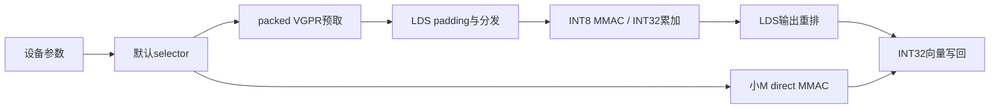

# INT8 NT流水、实例与默认分流

本轮格式为INT8×INT8→INT32、NT、无scale。两种计算pipeline类：direct与packed-LDS；编译14个实例，当前1178条覆盖其中10个。实例数量不能等同独立pipeline数量。其他实例服务于公开域回退或保留登记。

| ID | pipeline | BM×BN×BK | wave M×N | 用途 | 正式shape数 | 最小R | R中位数 |
|---:|---|---|---|---|---:|---:|---:|
| 6004 | direct | 16×64×32 | 1×4 | 无LDS | 522 | 0.5418 | 1.0138 |
| 6005 | packed | 32×128×64 | 2×2 | mask | 104 | 0.7826 | 1.4586 |
| 6006 | packed | 64×128×64 | 2×2 | mask | 92 | 0.8057 | 1.4065 |
| 6007 | packed | 128×128×64 | 2×2 | ragged/empty回退 | 0 | — | — |
| 6008 | packed | 128×256×64 | 2×4 | 保留已登记实例 | 0 | — | — |
| 6035 | packed | 128×128×64 | 2×2 | 小K，合并输出条带 | 61 | 0.6905 | 1.0891 |
| 6041 | packed | 256×256×64 | 4×2 | 大K、中等M，参数缓存 | 106 | 0.5083 | 0.6000 |
| 6042 | packed | 128×256×64 | 2×4 | M128，大K | 53 | 0.9161 | 1.2068 |
| 6043 | packed | 256×256×64 | 4×2 | 大K，mask回退 | 0 | — | — |
| 6044 | packed | 128×128×64 | 2×2 | 小K，mask回退 | 4 | 1.7216 | 2.3704 |
| 6048 | packed | 256×256×64 | 4×2 | 大M、大K，N优先 | 82 | 0.5210 | 0.5625 |
| 6049 | packed | 128×128×64 | 2×2 | 大M、小K，M tile分组8 | 116 | 0.5948 | 0.7640 |
| 6050 | packed | 128×128×64 | 2×2 | 大M、小K，mask、M分组8 | 0 | — | — |
| 6061 | packed | 16×256×64 | 1×4 | M16、大K专用tile | 38 | 1.0461 | 1.2116 |

## 选择规则

先验证gfx936、NT、INT8_INT32、公共N/K、K16/N4及容量/group约束。基础路径按M<=16、<=32、<=64及其余分为direct、32tile、64tile和128tile。

只有common且无empty/ragged标志、满足完整tile对齐时才启用无mask候选。大M的小K用M tile分组8，大M的大K用N优先；中等M按K与M/N对齐选择128或256tile。M16且K>=4096、K64/N256对齐时改选专用16×256。具体条件以selector源码为准，未依据模型、phase或case ID选核。

M是设备长度容量时，capacity/G只用于选择启发式；实际grid覆盖完整容量，GPU按每组真实长度保护边界，不在host回读长度。当前1178条是等长组性能覆盖，ragged/empty另做正确性验证。

## 数据流

direct减轻小M的同步成本；packed路径将连续搬运与计算片段分布分开。K64单缓冲预取控制LDS生命周期，peeled循环减少热循环分支，参数局部缓存减少重复读取。输出重排及大M tile遍历分别处理写回与调度退化。

性能解释以受控计时、数值、资源及ISA记录为依据；没有把未采集的缓存或occupancy计数写成事实。正式数据见results/final_01，资源及统一入口GPU代码一致性见docs中的JSON。
